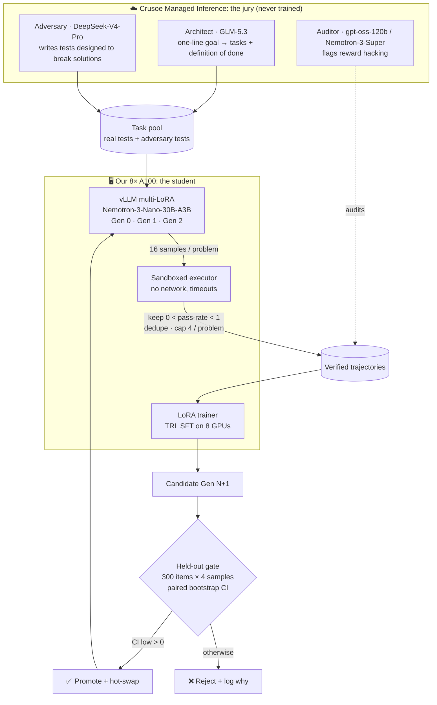

<p align="center">
  
</p>

<p align="center">
  <a href="#how-it-works">How it works</a> ·
  <a href="#results">Results</a> ·
  <a href="#quickstart">Quickstart</a> ·
  <a href="docs/PLAN.md">Plan</a> ·
  <a href="docs/RESEARCH.md">Research</a> ·
  <a href="docs/PROVENANCE.md">What we built today</a>
</p>

<p align="center">
  
  
  
  
  
</p>

---

> **Most agent teams are exactly as good on run 100 as on run 1.** Teams that "self-improve"
> usually rewrite a prompt and call it learning.
>
> **Ouroboros rewrites its own weights.** After every run, the team keeps only the work that
> provably passed, fine-tunes its successor on it, and puts that successor through an exam it
> has never seen. A jury of *other* models, which the student can't influence, decides whether
> the new brain is promoted or rejected.

## Why it's different

| Typical self-improving agent | Ouroboros |
|---|---|
| Edits its own prompt | Edits its prompt **and trains new weights** (LoRA generations) |
| Grades itself | **No model ever grades itself.** Solver, test-writer and auditor come from different model families |
| "It seems better" | **Paired bootstrap confidence interval** on 300 held-out problems. Promotion only if the lower bound > 0 |
| Keeps every change | A **promotion gate** rejects regressions and logs the reason |
| One agent | A **population** of adapters served side by side with vLLM multi-LoRA |

## How it works



### Two clocks
| Loop | Period | What changes | Scored on |
|---|---|---|---|
| **Fast** | minutes | system prompts / playbooks | dev split |
| **Slow** | ~1 hour | model weights (LoRA generation) | locked held-out split |

The held-out split is never used for training or for prompt search.

### Design decisions, and the research behind each
Full cited report: [`docs/RESEARCH.md`](docs/RESEARCH.md) (17 papers, built with Consensus).

- **Expert iteration with difficulty filtering, not GRPO.** Expert iteration matches or beats PPO in most setups, and GRPO's advantage comes mainly from discarding prompts where every sample failed. We keep only problems with pass rate strictly between 0 and 1, which gets most of GRPO's benefit with plain SFT plumbing. ([1.1], [6.2])
- **Two generations, not ten.** Self-training gains usually plateau after about 2 iterations. A rejected Gen 3 is still a useful result: it shows the gate working. ([2.1], [5.2])
- **Anti-collusion by construction.** When one model writes both code and tests, it learns to write easy tests. The test writer and the student are different model families, and tests are validated by cross-execution agreement. ([8.1], [7.3])
- **Statistics instead of vibes.** Expected gains are +3 to +7 pass@1 points. A gain that size is invisible on 50 items, so we use 300 items, 4 samples each, and paired per-item comparison. ([10.2], [15.2])

### Done Means Done
The Architect turns a one-line goal into a **task spec + executable test suite**: a definition of
done the system checks without a human. A loop detector stops and re-plans when a solver
repeats the same failing output 3 times or makes no progress across turns. The Auditor
flags solutions that special-case the tests.

## Results

> Filled in live on 2026-10-17. Every number below comes from `gens/*/gate.json`.

| Generation | Held-out pass@1 | Δ vs parent | 95% CI | Gate |
|---|---|---|---|---|
| Gen 0 (base) | _TBD_ | n/a | n/a | baseline |
| Gen 1 | _TBD_ | _TBD_ | _TBD_ | _TBD_ |
| Gen 2 | _TBD_ | _TBD_ | _TBD_ | _TBD_ |

## Quickstart

> The code is written during the hackathon (10:45 AM to 5:00 PM PT, 2026-10-17).
> These commands describe the target interface. See [`docs/SETUP.md`](docs/SETUP.md) for environment prep.

```bash
git clone https://github.com/ptlnextdoor/ouroboros && cd ouroboros
cp .env.example .env            # CRUSOE_API_KEY=...
uv sync

# 1. serve the student with hot-swappable LoRA adapters
ouroboros serve --model nvidia/NVIDIA-Nemotron-3-Nano-30B-A3B --gpus 0-7

# 2. baseline on the locked held-out set
ouroboros eval --gen 0

# 3. run the loop: sample → filter → train → gate → promote
ouroboros evolve --generations 2

# 4. demo UI (lineage tree, gate chart, live hot-swap)
ouroboros ui
```

## Repo layout

```
ouroboros/
├── assets/            banner + demo media
├── docs/
│   ├── PLAN.md        full plan: architecture, budget, pre-mortem, demo script
│   ├── RESEARCH.md    cited literature review (Consensus)
│   ├── SETUP.md       pre-event environment checklist + smoke tests
│   ├── WORKFLOW.md    how we build: spec-first swarm, techniques from past winners
│   ├── ALTERNATIVES.md ideas we considered and why we passed
│   └── PROVENANCE.md  exactly what existed before 10:45 vs built today
├── CLAUDE.md          context file for coding agents
└── (src/ written on the day)
```

## Stack

| Layer | Tool | Built today? |
|---|---|---|
| Student model | NVIDIA Nemotron-3-Nano-30B-A3B (fallback: Qwen3-8B) | ❌ pre-existing weights |
| Jury | Crusoe Managed Inference (GLM-5.3, DeepSeek-V4-Pro, gpt-oss-120b, Nemotron-3-Super) | ❌ hosted API |
| Serving | vLLM (multi-LoRA) | ❌ library |
| Training | Hugging Face TRL + PEFT | ❌ library |
| Data | TACO / APPS train, LiveCodeBench (held-out) | ❌ public datasets |
| **Generation loop, filters, sandbox, gate, jury orchestration, prompt evolution, UI** | ours | ✅ **yes** |

See [`docs/PROVENANCE.md`](docs/PROVENANCE.md).

## Team
- Aayushya Patel ([@ptlnextdoor](https://github.com/ptlnextdoor))
- _teammates added on the day_

Built at the **Recursive Agents Hackathon** (Crusoe × Cerebral Valley), Shack15, San Francisco.

## License
[MIT](LICENSE)
