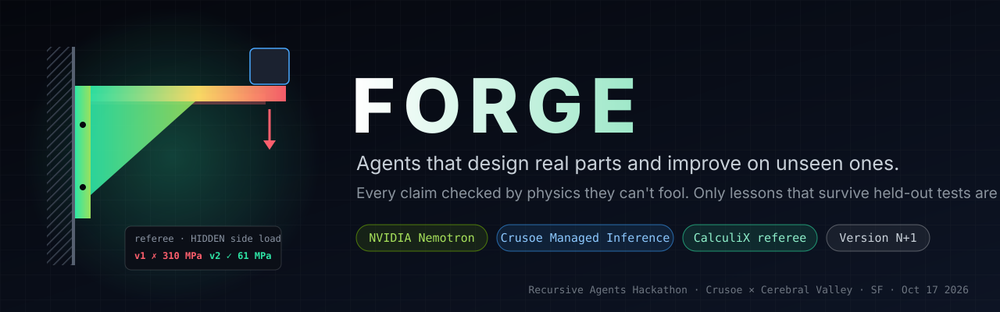
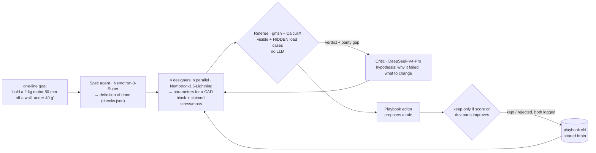

<p align="center"></p>

<p align="center">
  
  
  
  
</p>

> Last night our own design optimizer crowned a part with **negative drag** as its best result.
> Nothing in the loop caught it. Agents fill vague goals with assumptions and then report success.
>
> **FORGE** is an agent team that turns a one-line engineering goal into a real, manufacturable part.
> It checks every claim against a physics solver it can't see inside, on loads it was never told about.
> After each run it rewrites its own engineering playbook, and it keeps a rule only if the team does
> measurably better on parts it has never seen.

## How it works



| problem statement | how FORGE answers it |
|---|---|
| **Done Means Done** | The spec agent turns one line into numeric checks (load × g-factor, factor of safety, mass, deflection). "Done" means the referee passed every check, including loads the agents never saw. A loop detector re-plans when designs repeat or stop improving. |
| **Version N+1** | After each run a playbook editor proposes engineering rules from the failures. A rule is kept only if the dev-set score improves. v0 vs vN is reported on **held-out parts never used for editing**. Rejected edits stay in the log. Then the designer's *weights* get the same treatment: referee-verified designs become a LoRA fine-tune on Crusoe. |
| **Shared Brain** | The playbook is the team's shared memory. Every designer reads it before working, and its value is measured by held-out score, not by how it reads. |

### Memory: three tiers, one promotion rule
| tier | what | gate |
|---|---|---|
| notebook | every attempt: params → verdict → critic hypothesis (`trace.json`) | none, raw experience |
| playbook | plain-English rules the team wrote from its own failures (`playbook/vN.md`) | kept only if dev score rises |
| weights | referee-verified (goal → params) pairs distilled into a Nemotron LoRA via Crusoe Serverless Fine-Tuning (`forge/distill.py`) | promoted only if held-out score rises |

Design rationale and the compute decision (Crusoe over our 8×A100s: the bottleneck is physics, not FLOPs) are in [`docs/BACKEND.md`](docs/BACKEND.md).

### Why the referee can't be fooled
- **It isn't an LLM.** It's a 2nd-order tetrahedral FEA run (gmsh + CalculiX), checked against beam theory at **0.18 % error** (`make selftest`).
- **Hidden load cases** live in `referee/hidden/`, which agent code never imports (`make verify-isolation`).
- **Failures we've actually hit become explicit FAILs:** meshes that fail, invalid geometry, asymmetric response to a symmetric load, a solution that does negative work, and mass recomputed from the STEP rather than taken from the agent.
- **Parity gap:** the agent's claimed stress vs the solver's. This is our simulation-vs-reality metric.
- Every verdict records the hash of the exact STEP file it solved.

## Results

> Filled from `playbook/history.jsonl` and `runs/` on 2026-10-17. Every number has a replayable run.

| | held-out pass rate | mean iterations to pass | mean mass margin | $ per verified part |
|---|---|---|---|---|
| playbook v0 | _TBD_ | _TBD_ | _TBD_ | _TBD_ |
| playbook vN | _TBD_ | _TBD_ | _TBD_ | _TBD_ |

## Run it

```bash
cp .env.example .env              # CRUSOE_API_KEY='...'
make selftest                     # blocks + referee physics vs beam theory
make verify-isolation             # proves agents can't see hidden load cases
make demo TASK=motor_2kg_80mm     # one goal end-to-end
make nplus1                       # playbook rounds: train → gate on dev → score held-out
python -m forge.distill --dry-run # harvest referee-verified designs → gens/gen1/*.jsonl
python -m forge.distill --launch  # Crusoe Serverless Fine-Tuning job on Nemotron (LoRA)
python3 ui/serve.py               # live view; ?replay=runs/<run> replays a finished run
```

Requires Python 3.11+, CadQuery 2.8, and gmsh + CalculiX (both bundled with FreeCAD.app on macOS; set `FREECAD_BIN` elsewhere).

## Models (all on Crusoe Managed Inference)
| role | model | why |
|---|---|---|
| spec agent | `nvidia/NVIDIA-Nemotron-3-Super-120B-A12B` | structured checks from plain English |
| designers ×4 | `nvidia/Nemotron-3.5-Lightning-30B-A3B` | cheap parallel sub-agents, 1.3 s per design |
| critic + playbook editor | `deepseek-ai/DeepSeek-V4-Pro` | different model family, so no model grades its own work |
| referee | **none** (CalculiX) | physics, not opinion |

Every call is logged with its cost to `runs/<run>/calls.jsonl`. A hard per-run budget cap stops the loop.

## What we learned building it
- **LLMs can't write raw CAD yet.** Nemotron-3-Super, Lightning, DeepSeek-V4-Pro and GLM-5.3 failed 6 of 6 times on raw CadQuery code. Choosing parameters for a CAD block succeeded 6 of 6 times in about 1.5 s. Agents decide the engineering, and code builds the geometry.
- **Agents drift from the spec without saying so.** Asked for 80 mm of reach, a designer returned 100 mm and 150 mm. That's why the definition of done is written as checks the referee runs, not as instructions in the prompt.
- **Thinking mode was 30× slower and returned empty content** for our parameter task, so designers run with thinking off.

## Built today vs pre-existing
See [`docs/PROVENANCE.md`](docs/PROVENANCE.md). In short: CadQuery, gmsh, CalculiX and the models are tools. All code in `forge/`, `referee/`, `ui/`, `tasks/` and `playbook/` was written during the event. The planning docs in `docs/` were written the night before.

## Team
- Aayushya Patel ([@ptlnextdoor](https://github.com/ptlnextdoor)): mechanical and aero engineering
- Krish Garg ([@krishhgg](https://github.com/krishhgg)): agents and systems

Built at the **Recursive Agents Hackathon** (Crusoe × Cerebral Valley), SHACK15, San Francisco · [MIT](LICENSE)
