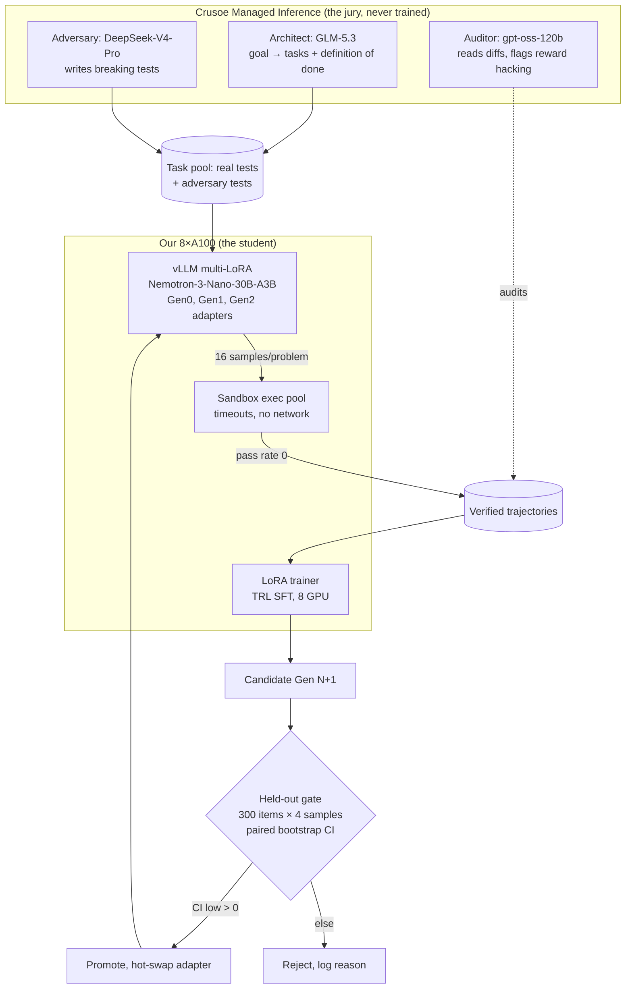
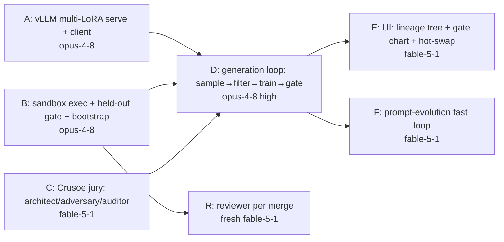

# OUROBOROS v2: research-hardened plan
Recursive Agents Hackathon, Shack15 SF, Sat 2026-10-17. Hack 10:45 to 5:00 (6h15m).

Research report (17 papers, cited): [View this in Consensus](https://consensus.app/search/i-am-designing-a-self-improving-llm-agent-system-t/qT_Q2DgMRGSukTfbCgFREA/)
Bracketed markers like [6.2] point to quotes in [RESEARCH.md](RESEARCH.md).

---

## 1. The pitch (one sentence)

> "Every agent team here rewrites its prompts. Ours rewrites its own weights, and a jury of
> other models it can't bribe decides whether the new brain is allowed to live."

Track: **Version N+1** (primary), **Done Means Done** (the reward signal), **Nemotron prize**.
The single "oh, this is possible now" moment (judges' #1 ask): **live hot-swap of Gen 2 onto
a problem Gen 0 failed on stage, plus a held-out chart with a confidence interval.**

---

## 2. What the research changed (v1 to v2)

| v1 assumption | Evidence | v2 decision |
|---|---|---|
| Many generations, GRPO as stretch | Expert iteration matches or beats PPO in most setups [1.1][1.3]. GRPO's edge mostly comes from *dropping prompts where every sample failed*, not normalization [6.2]. RAFT 52.3 vs GRPO 56.3 vs Reinforce-Rej 56.4 avg [6.1] | **Kill GRPO.** Run rejection-sampling FT (RAFT++ style) **with difficulty filtering**: train only on problems with pass rate strictly between 0 and 1. Gets most of GRPO's gain with SFT plumbing. |
| "Gen 0 to Gen 5" chart | Gains plateau after ~2 iterations (overfitting) [2.1]; two ReST iterations suffice to distill big→small [5.2] | Plan **exactly 2 generations**, a 3rd only if time allows. A plateau or rejected Gen 3 is a feature: the gate caught it. |
| Train on whatever passes | Positive-only filtering over-trains easy problems [4.2]; diversity is the bottleneck [1.2] | Cap samples per problem (≤4 correct, deduped), oversample hard (low pass rate) problems [4.3]. |
| Crusoe model writes tasks+tests, done | Self-generated tests are the #1 failure point; collusion when one model writes code and tests [7.1][8.1] | **Solver and tester are different model families.** Tests are validated by cross-execution agreement across many solutions [7.3][9.1]. Base training pool uses tasks with **real** tests; teacher only *adds* adversarial tests [10.1]. |
| ~50 held-out items | Detecting 2 to 5 pt gains needs far more items; use paired tests per item [15.2] | **≥300 held-out items, 4 samples each**, paired bootstrap CI on per-item pass rate. Promotion requires CI lower bound > 0. |
| Expect big jumps | Realistic: **+3 to +7 pts pass@1** (ACE 3 to 7 [10.2], ReasonFlux +5.3 [17.1], SePO prompt-only +4.5 [14.1]) | Pitch the *mechanism and the gate*, not the size. Prompt loop adds ~+4 pts cheaply on top. |
| ~1k examples enough? | ~1,100 verified examples on 8×A100 gave measurable gains on a 3B model [3.3][3.5] | Target **1,000 to 3,000 verified trajectories per generation.** |

---

## 3. Architecture

Three tiers of models from four vendors make the key Q&A answer: **"No model ever grades itself."**

**Two clocks:**
- Fast (minutes): playbook/system-prompt evolution scored on a *dev* split (never the held-out).
- Slow (~1 hour): weight generations.

**Done Means Done tie-in:** the Architect converts a one-line goal into a task spec + test suite =
the machine-checkable definition of done. Loop detector: if a solver repeats the same failing
output hash 3 times, or the patch is unchanged across turns, stop and re-plan. The Auditor
flags "special-casing tests" (e.g. `if input == ...` hardcoding), which shows up a lot in
reward hacking.

---

## 4. Model + data choices (verify ALL tonight)

| Role | Pick | Why | Fallback |
|---|---|---|---|
| Student | `nvidia/NVIDIA-Nemotron-3-Nano-30B-A3B` (BF16 for training) | Same model Crusoe serves, so the story is "Crusoe hosts base, we evolve it." 3B active = fast sampling. NVIDIA has an official LoRA recipe. | `Qwen3-8B` dense (if hybrid Mamba-MoE LoRA breaks in vLLM/PEFT). Keep Nemotron-3-Super as a Crusoe juror to stay prize-eligible. |
| Architect | `zai/GLM-5.3` on Crusoe | strong, 1M ctx | DeepSeek-V4-Flash |
| Adversary tests | `deepseek-ai/DeepSeek-V4-Pro` | different family from student | Qwen3.8-27B |
| Auditor/judge | `openai/gpt-oss-120b` or `Nemotron-3-Super-120B` | third family | GLM-5.3-Flash |
| Train pool | TACO / APPS train / CodeContests train (licensed, real tests) | verifiable, avoids bad-test collapse [7.1] | MBPP+ train |
| Held-out | LiveCodeBench problems dated **after** student's cutoff (easy+medium), 300 items | contamination-resistant | HumanEval+ + MBPP+ test (state contamination caveat) |

Budget: $50 Crusoe credit. Jury calls are small (task specs, test writing, audits). Use V4-Flash for bulk.

---

## 5. Compute budget per generation (8×A100)

| Step | Estimate |
|---|---|
| Sample: 600 problems × 16 samples, ~1k tok each, 4 vLLM replicas (TP=2) | 15 to 25 min |
| Sandbox exec + filter | 5 min (parallel processes) |
| LoRA SFT on 1 to 3k trajectories, 2 epochs | 15 to 30 min |
| Gate eval: 300 × 4 samples × (parent + child) | 10 min |
| **Total** | **~50 to 70 min** → Gen 1 by ~1:30, Gen 2 by ~2:45, Gen 3 optional by 4:00 |

---

## 6. Pre-mortem: what fails, how you see it, what you do

| # | Failure | Prob | Detect | Fallback |
|---|---|---|---|---|
| 1 | Nemotron hybrid MoE LoRA won't train or serve in vLLM | 30% | tonight's smoke test | Qwen3-8B student; Nemotron stays as juror |
| 2 | Gen 1 gain inside noise | 35% | CI crosses 0 | (a) prompt loop gives its own +gain; (b) present "gate refused" honestly; (c) report pass@k too |
| 3 | Reward hacking / bad tests | 20% | Auditor flags, pass rate jumps on train but not held-out | cross-execution test validation, drop disagreeing tests |
| 4 | Venue wifi can't reach cluster | 15% | test on arrival 9:00 | phone hotspot + tailscale; cluster runs headless anyway |
| 5 | Pipeline debugging eats afternoon | 40% | Gen 1 not started by 12:30 | hard cut: freeze scope, ship 1 generation |
| 6 | Live demo stalls on stage | 25% | rehearsal | every stage reads cached artifacts; the live part is only the adapter hot-swap + one problem (~10 s) |
| 7 | Disqualification on "new work" | 5% | | public repo, commits start 10:45, README lists pre-existing: base models, vLLM, TRL, datasets |

Nothing gets this to "cannot fail". This table gets it to "a degraded demo still holds up."
Floor outcome (all fallbacks used): a working Done-Means-Done jury + prompt evolution + one weight generation honestly rejected by the gate. That's still top-6 material on technicality.

---

## 7. Dev pipeline (Fable swarm, winner-tested workflow)

Techniques borrowed from repeat winners:
- **Think backward** from the winning demo, then check feasibility. (Jonathan, 5/5 hackathon wins: the YouTube video)
- **/interview to a master spec first**, then split it into *independent* tasks, one subagent per task in its own worktree. He won a 24h hack in 8 to 9 working hours this way.
- **Plan → build → fresh reviewer** triad (Everything Claude Code, Anthropic hackathon winner).
- Judges: problem first, something working inside 90 s, mock the slow parts, rehearse with a timer (JetBrains judging notes).
- Live demos beat faked ones because judges know most teams fake.

### Kickoff 10:45 to 11:15 (humans + coordinator)
1. Run `/interview` on this PLAN.md → write `SPEC.md` with **frozen interfaces** (file formats below).
2. Write `CLAUDE.md` (<200 lines): stack, interfaces, "don't touch other nodes' files."

**Frozen interfaces (these allow parallel work):**
- `tasks.jsonl`: `{id, prompt, tests:[...], source, difficulty}`
- `samples.jsonl`: `{task_id, gen, adapter, completion, passed, n_pass, n_total}`
- `gens/<N>/`: `adapter/`, `train.jsonl`, `gate.json {parent, child, delta, ci_low, ci_high, decision}`
- `events.jsonl`: append-only log the UI tails

### Swarm DAG (max 2 to 3 live builders, one worktree each)

- Each node ships one runnable check (e.g., `python -m gate --selftest` asserting bootstrap on synthetic data).
- Reviewer = fresh context, reads diff + runs check, no author bias.
- Gen 0 baseline eval starts **the moment A+B land** (target 12:00). The cluster should never sit idle.

### Timeline
| Time | Milestone |
|---|---|
| 9:00 | Arrive, test cluster reachability, claim Crusoe credits, form team |
| 10:45 | Spec + CLAUDE.md, spawn A, B, C |
| 12:00 | Gen 0 baseline score on held-out (this number is in the demo) |
| 12:30 | **Hard checkpoint:** D running. If not, cut to 1 generation. |
| 1:30 | Gen 1 gated |
| 2:45 | Gen 2 gated; E + F built in parallel |
| 4:00 | Feature freeze. Optional Gen 3 runs in background (if rejected, it goes in the demo) |
| 4:15 | Record 1-min video, rehearse 3-min demo ×3 with timer |
| 5:00 | Submit |

---

## 8. Three-minute demo script

1. **0:00 Problem (20 s):** "Agent teams are as good on run 100 as run 1. They rewrite prompts and call it learning."
2. **0:20 Done Means Done (30 s):** type a one-line goal live. The Architect produces a spec + tests, and the Adversary adds breaking tests.
3. **0:50 The loop (40 s):** lineage tree: Gen 0 → Gen 1 → Gen 2 (→ Gen 3 rejected). Click a node to see training-set size, pass-rate filter, and the auditor's flags.
4. **1:30 The receipt (30 s):** held-out chart, paired bootstrap CI, and the statement "these 300 problems were never trained on and never used for prompt search."
5. **2:00 The moment (40 s):** hot-swap Gen 0 → Gen 2 live on a held-out problem Gen 0 failed. Green.
6. **2:40 Close:** "Run 100 beats run 1, and we can prove it. No model ever grades itself."

Q&A prep: why not GRPO [6.2]; why 2 gens [2.1]; how you stop reward hacking [8.1][7.3]; why the
CI [15.2]; what's pre-existing vs built today.

---

## 9. Tonight's checklist (environment only, no project code)

- [ ] `vllm serve nvidia/NVIDIA-Nemotron-3-Nano-30B-A3B --enable-lora` with a dummy adapter. Does it load?
- [ ] PEFT LoRA forward/backward on Nemotron-3-Nano, 10 steps. If it fails, switch student to Qwen3-8B and re-test.
- [ ] Download weights for student + fallback, TACO/APPS train, LiveCodeBench release with dates.
- [ ] `curl https://api.inference.crusoecloud.com/v1/models` with key; confirm model IDs above.
- [ ] Tailscale/ssh to cluster from a different network (phone hotspot).
- [ ] Install/enable skills: /interview (or grill-me), reviewer agent; trim others.
- [ ] Sleep. (Jonathan's all-nighter advice is for 24h hacks. This one is 6h.)

## 10. Odds (honest)
- Top 6: **45 to 55%**. Win: **20 to 30%**. Nemotron prize: **25 to 35%** if the student stays Nemotron.
- Most likely way it goes wrong: failure #5 or #1 compresses the schedule so only Gen 1 exists and its gain is in the noise. Mitigation is already in the plan: the prompt loop's gain and an honest gate rejection still tell the story.
