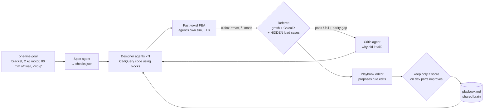

# FORGE: build spec (frozen at kickoff)

> Working name. One line: **agents that design real parts, prove them against physics they can't fool, and get better on parts they've never seen.**
> Tracks: **Version N+1** (primary), **Done Means Done** (spec → checks, referee), **Shared Brain** (playbook = shared memory). Nemotron for the RTX 5090 prize.

## Loop



## Roles → Crusoe models (verify IDs with GET /v1/models)
| role | model | why |
|---|---|---|
| Spec agent (goal → checks) | `nvidia/Nemotron-3-Super-120B-A12B` | Nemotron prize, structured output |
| Designer ×4 in parallel | `nvidia/nemotron-3.5-lightning-30b-a3b` | cheap, built for sub-agents |
| Critic / playbook editor | `deepseek-ai/DeepSeek-V4-Pro` or GLM-5.3 | stronger reasoning, different family |
| Referee | **no LLM**. CalculiX + rules | can't be talked into anything |

## Interfaces
```
tasks/{train,dev,heldout}/*.json   {id, prompt, hidden_loads:[...] (heldout+dev only, referee-only)}
runs/<run>/<task>/<iter>/part.py   agent CadQuery code
runs/.../part.step, claim.json      {sigma_max_MPa, defl_mm, mass_g}
runs/.../verdict.json               {pass, checks:[{name,limit,measured,ok}], parity_gap, hidden:[...], reason}
playbook/v<N>.md                    shared brain; diff + score delta per version
events.jsonl                        UI tails this
```

## Referee checks (from our own past failures, see HARVESTED_SKILLS.md §3)
1. geometry valid (closed solid, volume > 0) and mesh succeeded. A mesh failure is an explicit FAIL, never silently dropped.
2. mass = ρ·V, recomputed from the STEP, never the agent's number
3. σ_vm,max × FS ≤ allowable on **every** load case, visible and hidden
4. deflection ≤ limit
5. physics sanity: symmetric part + symmetric load → symmetric response; no negative stiffness
6. parity gap = |agent claim − ccx| / ccx, the headline "sim-to-real" number
7. STEP hash in the verdict (we once simulated a stale geometry)

## Shape blocks (agents compose these, which cuts broken CAD)
plate · rib · gusset · boss+hole · hole pattern · fillet edges · L-bracket · tube clamp

## Demo beats (3 min)
1. 0:00 hook: "Last night our own optimizer crowned a design with negative drag. Nothing caught it."
2. 0:20 type goal live → checks appear
3. 0:40 4 designer agents in parallel, parts rendering, stress red→green
4. 1:20 referee rejects one on a HIDDEN side load, parity gap shown
5. 1:50 playbook diff "+ gusset any cantilever > 50 mm" kept (+score) vs a rejected edit (−score)
6. 2:20 v1 vs v2 on 10 unseen parts, same budget
7. 2:45 close: "Every number checked by physics it can't fool. Run 100 beats run 1."
