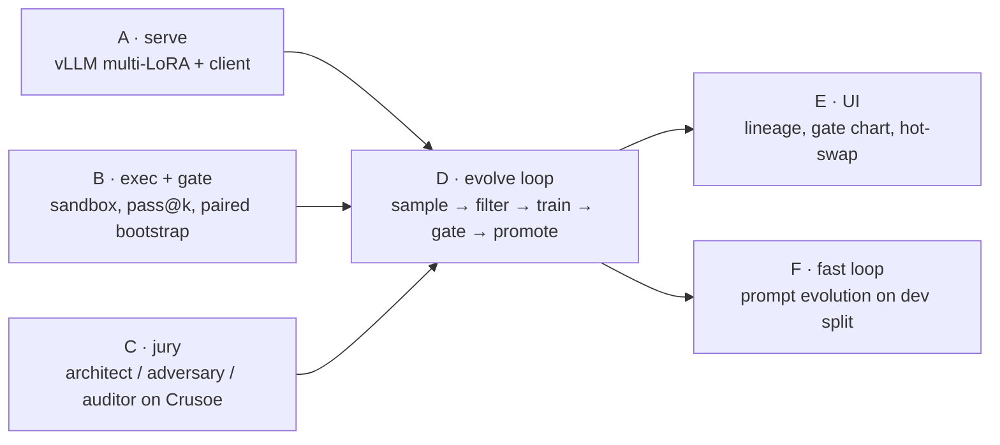

# Workflow: how we build in 6 hours

## Techniques taken from people who keep winning

| Source | Technique | How we apply it |
|---|---|---|
| ["The Claude Code workflow that helped me win 5 Hackathons in a Row"](https://www.youtube.com/watch?v=AoxK3JpxbRc) (prizes at Stanford, Yale, Columbia hacks) | **Think backward.** Picture the demo that won, then check it's feasible | Our "moment" is a live hot-swap Gen 0 → Gen 2 on a problem Gen 0 failed, plus a CI chart |
| same | **/interview → master spec**, then split it into independent tasks, one subagent each | 30-min spec at kickoff with frozen file interfaces, then parallel builders |
| same | Point agents at examples to copy rather than asking for originality | Give builders reference repos (vLLM LoRA example, TRL SFT example) |
| same | Fewer skills/MCPs. Too many constrain smart models | Trimmed agent config |
| same | Live demos beat faked ones | Only the hot-swap is live. Everything else replays real logged artifacts |
| [Everything Claude Code](https://github.com/affaan-m/ECC) (Anthropic hackathon winner) | **Plan → build → fresh reviewer** | Every merge reviewed by a fresh-context agent that runs the node's self-check |
| [JetBrains judging notes](https://blog.jetbrains.com/ai/2026/06/how-to-win-a-hackathon-notes-from-the-judging-table/) | Lead with the problem. Show something working inside 90 s. Mock the slow parts. Rehearse with a timer | Demo script in [PLAN.md §8](PLAN.md) |
| [Hackathon Strategy Guide, ch. 8](https://yarmoluk.github.io/hackathon-strategy-guide/chapters/08-building-with-claude-code/) | Short CLAUDE.md written at kickoff, updated each milestone | [`CLAUDE.md`](../CLAUDE.md) |

## Frozen interfaces (agree at 10:45, don't change)

```
data/tasks.jsonl      {id, prompt, tests: [str], source, difficulty, split: train|dev|heldout}
runs/samples.jsonl    {task_id, gen, adapter, completion, passed, n_pass, n_total, ms}
gens/<N>/adapter/     PEFT adapter
gens/<N>/train.jsonl  SFT examples actually used
gens/<N>/gate.json    {parent, child, n_items, parent_acc, child_acc, delta, ci_low, ci_high, decision, reason}
runs/events.jsonl     append-only {ts, kind, payload}  ← UI tails this
```

## Build graph



Rules:
- One node = one worktree = one owner. No two builders edit the same files.
- Max 2 to 3 live builders at once.
- Every node ships a self-check (`python -m ouroboros.gate --selftest`, etc.) that the reviewer runs.
- **The cluster never sits idle.** Gen 0 baseline eval starts the moment A + B land.

## Checkpoints (hard cuts)

| Time | Must be true | If not |
|---|---|---|
| 12:00 | Gen 0 held-out score exists | debug A/B only, pause C |
| 12:30 | evolve loop running | cut to 1 generation |
| 2:45 | Gen 2 gated | demo with Gen 1 |
| 4:00 | **feature freeze** | no exceptions |
| 4:15 | video recorded, demo rehearsed 3× with timer | |
| 5:00 | submitted, repo public, teammates added | |
